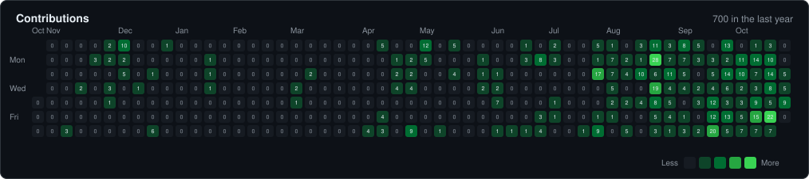
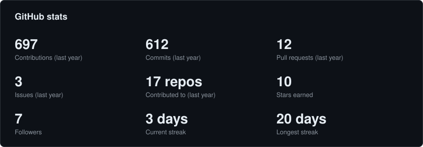
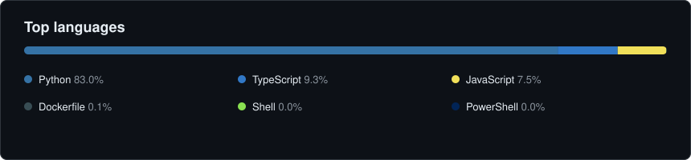

# Hi, I'm Tareq 👋

**Full-stack developer · AI tooling builder · Researcher**
I build AI-powered products and ship them in public. Based in Bangladesh.

> 🔎 **Open to work:** AI engineer · full-stack · AI tooling roles

---

## 🚀 Start Here

- 🔌 [**Invincible**](https://github.com/tareq199923/invincible) ([invincible-ai.me](https://invincible-ai.me/)): one gateway for many free-tier LLM providers, with automatic failover and an MCP tool server for AI agents
- 📚 [**Book Dialogues**](https://github.com/tareq199923/book-dialogues): AI-generated literary debates between books and ideas, streamed live

---

## 🛠️ What I'm Shipping

### [Invincible](https://github.com/tareq199923/invincible): Multi-provider LLM gateway + MCP tool server
Free-tier LLM limits kept breaking my coding sessions mid-task, so I built a gateway that switches providers for me and keeps the context.

**What's live:** automatic failover across providers (Gemini, OpenRouter, Groq, NVIDIA NIM and more), bring-your-own-key setup, MCP server for AI agents, OAuth 2.1 + PKCE auth, shared memory and task continuity across models, PostgreSQL storage, web dashboard. Published as `invincible-ai` on PyPI.
**Stack:** `Python` · `FastAPI` · `PostgreSQL` · `SQLAlchemy` · `MCP`

### [Book Dialogues](https://github.com/tareq199923/book-dialogues): AI literary debates
Pick books or thinkers and watch an AI stage a debate between them, streamed live.

**What's live:** streaming debates (SSE), bring-your-own Gemini key, magic-link login, per-user data isolation (Supabase RLS), deployed on Vercel.
**Stack:** `Next.js` · `Supabase` · `Gemini` · `Vercel`

---

## 🔬 Research

| Paper | Venue | Status |
|---|---|---|
| Hybrid TF-IDF and Explainable Supervised Learning Approach for Detecting Fake Reviews | 5th IEEE SPICSCON 2026 | Accepted |

---

## 🧰 Stack

---

## 📊 GitHub Activity

Refreshed daily by a GitHub Action. Languages exclude HTML, CSS, notebooks and TeX.

---

## 🎯 What I'm Doing

- **Building AI tooling:** gateways, agents, and tools that make LLMs practical
- **Shipping products:** small, real apps with live links
- **Researching:** explainable ML for text classification

## 💼 Background

- B.Sc. in Computer Science & Engineering, AIUB (2026)
- Web Developer at Join Venture AI (Jan to Jun 2026)
- Independent founder

---

## 🤝 Connect

---

> *Ship it, then make it better.*
